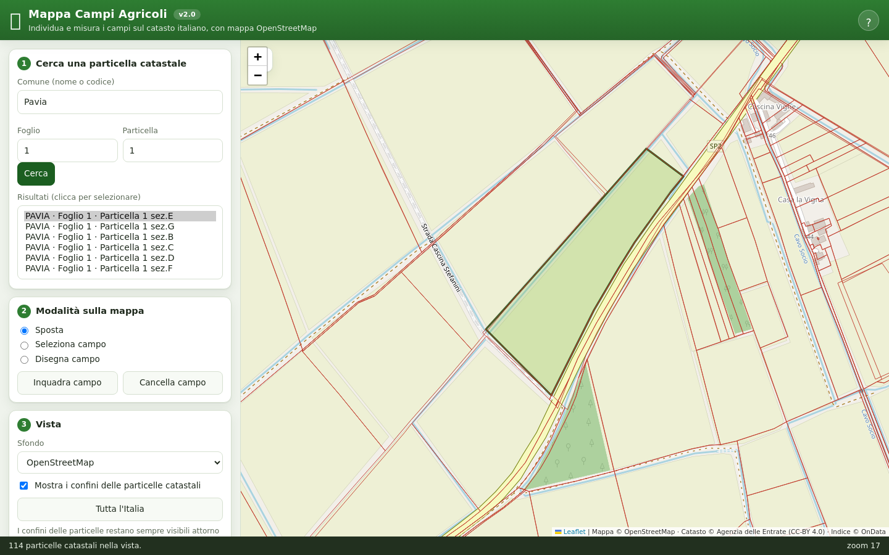

# Mappa Campi Agricoli — versione web

Applicazione **web** per **individuare, selezionare, disegnare e cercare campi
agricoli** su una mappa OpenStreetMap, con i confini delle particelle catastali
italiane sovrapposti. Gira interamente nel browser e si apre anche online su
GitHub Pages: **<https://mimmodc.github.io/mappa/>**



> Questo repository contiene **solo la versione web** (HTML + Leaflet).
> La **versione desktop** (Python + Tkinter) è mantenuta in un repository
> separato.

## Funzionalità

1. **Mappa OpenStreetMap** con sfondi alternativi: OSM, Satellite (Esri),
   Topografico (OpenTopoMap), HOT.
2. **Selezione di un campo** — clic sulla mappa in modalità *Seleziona campo*:
   la particella catastale sotto il cursore viene evidenziata e identificata
   (Comune / Foglio / Particella / Sezione) tramite il WFS dell'Agenzia delle
   Entrate.
3. **Disegno di un campo** — clic sulla mappa per aggiungere i vertici, poi
   *Chiudi poligono* per completare l'area.
4. **Ricerca in tutta Italia** per **Comune + Foglio + Particella**.
5. **Overlay delle particelle catastali** in due gruppi: quelle del **campo
   selezionato e delle zone confinanti** (sempre visibili, a qualunque zoom) e
   quelle della **vista corrente** (a zoom sufficientemente elevato).
6. **Calcolo di area, perimetro e centroide** (geodetici) ed **esportazione in
   GeoJSON** del campo selezionato o disegnato.

## Pubblicazione su GitHub Pages

Il sito è pubblicato dalla root del branch `main` di questo repository ed è
attivo su **<https://mimmodc.github.io/mappa/>**.

### Ripubblicare da zero (nuovo repository)

Prima crea su GitHub un repository **vuoto** chiamato `mappa` (senza README né
altro), poi dalla cartella del progetto:

```bash
git init
git add .
git commit -m "Versione web (GitHub Pages)"
git branch -M main
git remote add origin https://github.com/mimmodc/mappa.git
git push -u origin main
```

Poi, sul sito GitHub del repository:

1. **Settings → Pages**
2. *Source*: **Deploy from a branch**
3. *Branch*: **main**, cartella **/ (root)**
4. **Save**

Dopo un minuto il sito è attivo su **<https://mimmodc.github.io/mappa/>**.

> Il nome del repository deve essere esattamente `mappa` sotto l'account
> `mimmodc`, altrimenti l'indirizzo cambia. Per il piano gratuito il
> repository deve essere **pubblico**.
>
> Se il repository contiene già dei file (creato con README o con un primo
> caricamento), `git push` viene rifiutato: occorre prima allinearsi con
> `git pull --rebase origin main`.

## Configurazione del proxy CORS (già pronta)

Il WFS dell'Agenzia delle Entrate **non invia gli header CORS**, quindi il
browser non può interrogarlo direttamente: senza un piccolo proxy la ricerca
funziona ma i confini delle particelle non si vedono.

Il sito pubblicato **è già configurato**: in `web/config.js` è indicato il Worker
Cloudflare del progetto (piano gratuito):

```
https://mappa-proxy.mimmodc.workers.dev/?url={url}
```

Non serve quindi inserire nulla. Per usare un proxy diverso, basta scriverlo
nella sezione **5. Impostazioni (proxy WFS)** dell'app (deve contenere il
segnaposto `{url}`) e premere **Salva**; il pulsante **Verifica** controlla che
risponda. La scelta viene memorizzata nel browser. L'indirizzo deve essere in
**https://** (la pagina pubblicata è in HTTPS).

Per pubblicare un proxy proprio — su un altro account Cloudflare, o con Deno
Deploy/Vercel/Netlify — tutto il necessario è in
**[`proxy/README.md`](proxy/README.md)**.

## Avvio in locale (senza pubblicare)

```bash
node proxy/local-proxy.mjs      # proxy CORS su http://localhost:8787
python3 -m http.server 8123     # sito su   http://localhost:8123
```

e apri:

```
http://localhost:8123/?proxy=http%3A%2F%2Flocalhost%3A8787%2F%3Furl%3D%7Burl%7D
```

Il parametro `?proxy=...` viene memorizzato nel browser: dalle volte successive
basta aprire <http://localhost:8123/>.

## Note sulla versione web

- La ricerca per attributi usa **DuckDB-WASM**: i file Parquet di OnData sono
  letti direttamente via HTTP e sono ordinati per comune, quindi il browser
  scarica solo i blocchi di righe necessari (non i 10–70 MB completi).
- Area e perimetro usano la stessa libreria geodetica dell'app desktop
  (GeographicLib, algoritmo di Karney su WGS84): i valori coincidono.
- Il WFS dell'Agenzia delle Entrate risponde a volte con una **collezione
  vuota** per una bbox che contiene invece particelle, e la cache davanti al
  servizio ripete quella risposta vuota **identica per lo stesso URL**. Le
  richieste vengono perciò serializzate e distanziate di 120 ms, e un riquadro
  vuoto viene ritentato **variando di poco l'URL** (fino a 3 tentativi per il
  gruppo «campo»): è il motivo per cui i confini attorno al campo selezionato
  compaiono in genere entro un secondo.
- Nella console del browser è disponibile l'aggancio `mappaApp` per
  diagnostica: `mappaApp.map.getZoom()`, `mappaApp.state.field`, ecc.

## Fonti dati ed attribuzione

| Dato | Fonte | Licenza |
|---|---|---|
| Particelle catastali (poligoni) | [Agenzia delle Entrate — WFS INSPIRE](https://wfs.cartografia.agenziaentrate.gov.it/inspire/wfs/owfs01.php) | CC-BY 4.0 |
| Indice comune/foglio/particella → coordinate | [OnData — dati_catastali](https://github.com/ondata/dati_catastali) | CC-BY 4.0 |
| Sfondo mappa | OpenStreetMap contributors / OpenTopoMap / Esri | varie (aperte) |

Le attribuzioni sono riportate anche nella barra in basso della pagina.

## Note tecniche e limiti

- Il WFS dell'Agenzia delle Entrate accetta **solo query per bounding box**: non
  è possibile filtrare per attributi. La ricerca per Comune/Foglio/Particella
  usa quindi l'indice Parquet di OnData (letto via DuckDB-WASM su HTTP) per
  ricavare un punto interno alla particella, e poi interroga il WFS su quel
  riquadro.
- Il WMS dell'Agenzia delle Entrate **non supporta EPSG:3857** (Web Mercator),
  per questo le particelle sono disegnate come **vettori** dal WFS e non come
  tile sovrapposti: un overlay raster risulterebbe disallineato.
- L'area e il perimetro sono calcolati con la formula geodetica di Karney
  (`geographiclib`), non con geometria planare.
- Lo zoom del WFS è limitato a circa **1:5000** e il servizio **non restituisce
  elementi** quando la bounding box supera ~0.017° di lato (filtro di scala lato
  server). L'overlay è quindi formato da due gruppi:
  - **campo** — le particelle del campo selezionato o disegnato e quelle
    confinanti (margine minimo ~130 m): vengono caricate **sempre**, a
    qualunque zoom, e restano visibili come riferimento;
  - **vista** — le particelle della porzione di mappa visibile: vengono
    aggiornate solo a zoom ≥ 16 e, allontanandosi, il gruppo viene svuotato per
    non lasciare in mappa confini di zone diverse da quella osservata.
- Le aree più estese di ~0.017° di lato vengono suddivise automaticamente in
  riquadri (≤ `WFS_TILE_SPAN`, 0.012°) e i risultati uniti senza duplicati,
  perché il WFS altrimenti restituirebbe una risposta vuota.
- Il servizio catastale è esterno e può occasionalmente essere lento o non
  raggiungibile; le richieste vengono ripetute alcune volte e l'app mostra lo
  stato senza bloccare la mappa.

## Struttura del progetto

```
index.html                # pagina principale (root per GitHub Pages)
web/                      # versione web: stili e moduli JavaScript
  app.css                 #   foglio di stile
  config.js               #   configurazione (proxy, sfondi, costanti)
  geo.js                  #   area / perimetro / centroide (geodetici)
  gml.js                  #   parsing identificativi e risposte GML del WFS
  wfs.js                  #   client WFS con supporto proxy CORS
  catasto.js              #   ricerca per attributi (DuckDB-WASM)
  app.js                  #   logica dell'interfaccia
proxy/
  cloudflare-worker.js    #   proxy CORS per GitHub Pages (Cloudflare Worker)
  local-proxy.mjs         #   proxy CORS locale, per le prove
  README.md               #   guida all'attivazione del proxy
tests/
  all.test.mjs            #   test di geometria, parsing GML, client WFS
  fixtures/               #   risposta WFS di esempio
README.md                 # questo file
CHANGELOG.md              # cronologia delle versioni
.gitignore                # file esclusi dal versionamento
doc/                      # immagini usate nella documentazione
```

## Versione

Versione corrente: **2.0** (mostrata anche nel titolo della pagina).
La cronologia completa delle modifiche è in [CHANGELOG.md](CHANGELOG.md).

## Verifica rapida

Versione web (Node 18+, nessuna dipendenza obbligatoria):

```bash
node tests/all.test.mjs
```

Per eseguire anche i test che richiedono il parsing XML e il proxy:

```bash
npm install @xmldom/xmldom          # fornisce DOMParser a Node
node proxy/local-proxy.mjs &        # proxy CORS su :8787
MAPPA_TEST_DEPS="$PWD" \
MAPPA_PROXY_URL='http://localhost:8787/?url={url}' \
node tests/all.test.mjs
```

I test della versione web verificano il calcolo geodetico, il parsing delle
risposte GML e il client WFS (con la risposta reale del WFS come campione in
`tests/fixtures/`).

## Licenza

Il **codice** di questo progetto non è rilasciato con una licenza d'uso: tutti i
diritti sono riservati. I **dati** utilizzati restano invece soggetti alle
rispettive licenze indicate nella sezione «Fonti dati ed attribuzione».
